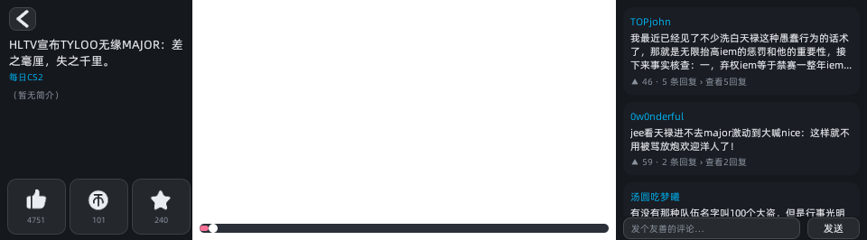
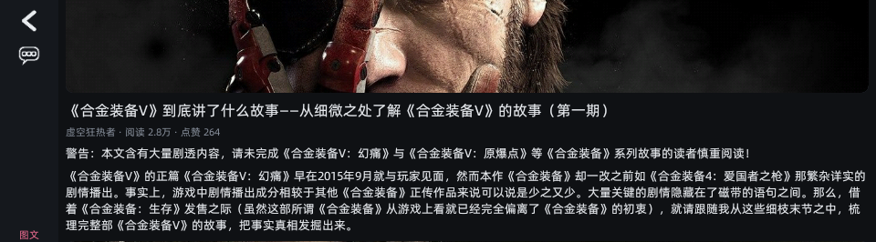
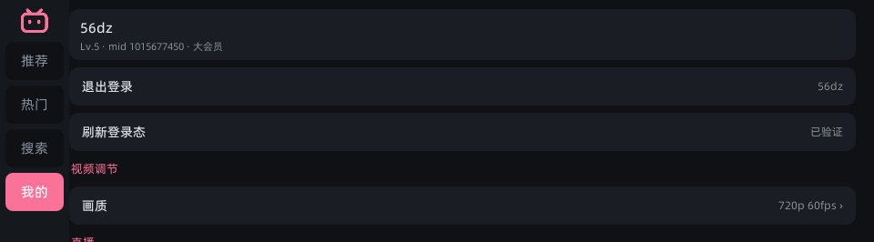

# PenBili

把哔哩哔哩装进有道词典笔。

这是一款跑在有道词典笔上的 B 站客户端，用有道自家的 Falcon 小程序框架（QuickJS + Vue 2 单文件组件）写成。屏幕只有 960×266 点，指甲盖大小，所以我按 iPad 版 B 站的骨架重做了界面，把推荐、搜索、播放、评论、图文、直播全塞进这一个页面里。

当前版本 `3.5.5`，只支持 **X6 Pro**（RK3562）。X5 分支已停止维护。


---

## 为什么值得做

词典笔是个奇怪的目标设备：4 核 A35、1GB 内存、一块 480×960 的竖屏（系统把它旋转 270° 当横屏用）、没有触摸屏只有一块手写板、跑着裁剪过的 Linux 和一套私有小程序运行时。

它能播 B 站，但难点不在"能不能播"，而在**播放质量**。B 站点播是 DASH 分离流（视频 m4s + 音频 m4s），设备上现成的播放器方案要么软解跑不动 720p，要么 seek 一次卡十几秒。所以我把整条播放链路重写了一遍——这才是这个项目的主要工作量。

---

## 截图

全部为 X6 Pro 真机采集，960×266。

**推荐流**


**热门**


**搜索（视频 / 图文 / 直播三栏）**


**播放页** —— 左列信息与互动、中列视频、右列评论



**图文详情**



**我的**



> 除播放页外，其余都是 `miniapp_cli capture` 原样抓的 Falcon 画布层。视频走 DRM/KMS
> 硬件平面直出，不在画布里，所以画布截图里视频区是黑的——不是 bug。播放页那张为了
> 展示真实效果，用 `kmssrc` 单独抓了平面帧，按平面几何（`/sys/kernel/debug/dri/0/summary`
> 里的 `Esmart1-win0` dst）贴回画布。抓帧必须在暂停后做，否则拿到的是解码器正在写的
> 缓冲区，全是撕裂条。

---

## 功能

**浏览**

- 推荐流、热门、搜索、我的四个 tab，卡片网格 5 列，加载更多按整行裁剪不留半行
- 搜索分「视频 / 图文 / 直播」三栏，各自独立缓存、独立页码，来回切换零请求

**播放**

- DASH 分离流按 qn 阶梯取最高可用档（`116`=1080P60 → `80`=1080P → `74`=720P60 → `32`=480P → `16`=360P），同档优先 AVC
- 点视频区暂停/继续；进度条拖动定位（拖动过程中零请求，松手后 250ms 才下发一次）
- 画质七档：「我的 → 视频调节」，`auto` / `1080p60` / `1080p30` / `720p60` / `720p30` / `480p30` / `360p30`
- 播放历史（最近 10 条，在「我的」页）

**互动**

- 点赞、投币（2 币，可同时点赞）、收藏（可挑收藏夹）
- 评论区：主楼 10 条/页、子楼 20 条/页，点主楼展开；系统输入法发评论
- 发评论时视频平面会自动隐藏，避免盖住键盘

**直播**

- 直连 B 站 `http_stream/flv/avc` 直链本地解码，不经过任何自建转码服务器
- 四档画质，下播检测、断流自动重连（退避 0/2/4/6/8 秒，最多 5 次）
- 直播态自动隐藏评论区、互动按钮和进度条，视频区撑满

**图文**

- 专栏详情按 `opus` 富文本段 → `content.ops` → `content` HTML 三级回退渲染
- 图片等比缩放，评论走 `type=12`

**登录**

- B 站 TV 协议扫码，二维码纯 CSS 渲染（零 inline style）
- 登录态持久化，过期前 60 秒判定失效

---

## 技术实现

### 播放子系统：为什么不能用现成方案

设备自带 GStreamer 1.22 和 Rockchip MPP 硬解，看起来直接用 `playbin` 就完事了。实际试下来每条路都堵死：

| 方案 | 结果 |
| --- | --- |
| `souphttpsrc` 直连 HTTP 播放 | **永远无法 seek**。souphttpsrc 只实现 push 模式的 `create()`、不实现 `pull_range`，qtdemux 在 push 模式下直接丢弃 seek 事件。它报的 `seekable: 1` 是骗人的，只看 `Accept-Ranges` 头 |
| ffmpeg 软解 + 逐帧贴 fb0 | 720p 只有 0.76x 实时，必卡 |
| ffmpeg 下载到本地 MP4 再播 | 增长中的 MP4 用 `filesrc` 读会永久卡死——`filesrc` 在打开时就把文件长度快照下来了 |
| ffmpeg 转 MPEG-TS 边下边播 | 双分支 preroll 永久卡死，且 ffmpeg 输出的时间戳错乱 |
| ffmpeg 转 fragmented MP4 边下边播 | 视频帧间隔严重超标（`<20ms` 区间 169 帧） |

最终方案是 **ffmpeg → 命名管道 → GStreamer**：

```
ffmpeg (-ss T, -c copy, -copyts, -f matroska) ──→ FIFO ──→ filesrc
                                                              │
                                    ┌─────────────────────────┴──────────────────┐
                                    │ matroskademux                              │
                                    ├── video: queue → h264parse → mppvideodec ──┤
                                    │          → videorate → kmssink(plane 76)   │
                                    └── audio: queue → aacparse → faad ──────────┤
                                               → audioresample → alsasink       │
```

几个关键决策，每一条都是实测撞出来的：

**容器必须是 Matroska。** 只有它逐簇写入、头部写完就能解码、不需要回填索引。MP4 的 moov 在尾部，TS 和 fMP4 各有各的坑。这个结论花了整整一轮实验才确认。

**单 FIFO + 单 demuxer，不是双 FIFO + 双 demuxer。** 早期版本让音视频各走一个 FIFO、各配一个 demuxer，结果 seek 后音频稳定领先视频 1~2 秒。根因是两个 demuxer 各自把 `segment.start` 定成"自己第一条流的 PTS"——视频从关键帧 K 开始（K ≤ T），音频精确从 T 开始，两条分支都在自己的 base_time 起播，于是内容 K 和内容 T 同时播，差 T−K（B 站关键帧间隔 1~2 秒）。改成单 demuxer 后只有一个 segment（start = 全局最小 PTS = K），内容 c 在两路的 PTS 都是 c、running_time 都是 c−K，天然对齐。

**`-copyts` 是 A/V 对齐的必要条件，但它和 `-t` 是致死组合。** `-copyts` 保留原始 PTS，这正是不对齐能修复的原因。但 ffmpeg 4.4.1 在 `-copyts` 下 `-t` 是按**原始时间轴**截断的——我原来的公式 `durationMs − baseMs + 5s` 在 base 较大时会算出小于原始 PTS 的值，于是所有包都被过滤掉，ffmpeg 返回码 0、输出 0 个包、stderr 全空。这个 bug 表现为"第三次 seek 必然起不来"，查了很久才发现。修法是 `-t` 直接用 `durationMs + 5s`。

**`render-rectangle` 是 write-only 的，而且只在 reconfigure 时被读取。** 键盘避让需要动态改视频矩形。播放态直接设属性就生效，但暂停态怎么设都没用——kmssink 只在重新分配 plane 时才读这个属性，PAUSED 下没有新帧流过就不会 reconfigure。所以暂停态改矩形必须**先设属性、再临时脉冲 PLAYING 触发 reconfigure、设完立刻切回 PAUSED**。顺序反了（先脉冲再设）就是 configure 读到旧值，完全无效——我在这里踩过一次，还因为探针设计不当误判成"已修好"。

另外两个坑：`render-rectangle` 只能缩小不能放大（1×1 之后想恢复必须整条管线过一次 READY，走 seek 重启路径）；零宽高不会隐藏平面，kmssink 会回退成"未设置 ⇒ 全屏"，所以隐藏必须用 1×1。

**起播要缓冲门，不能直接 PLAYING。** 直接 PLAYING 时，音频分支先 preroll 完成、管线时钟随即起跑，而视频分支（硬解首帧 + 队列排空）要晚 900~2100ms 才出帧，这批帧相对已经跑起来的时钟全部"迟到 >40ms"，被 `max-lateness` 成批丢弃——用户看到的就是"起播不是从头开始，直接从第 3 秒播"。修法是两段式：先 `set_state(PAUSED)`（时钟不走，没有帧会迟到），轮询等音视频分支都就绪，再切 PLAYING。代价是起播慢 1.7~2.4 秒，换来起播即满帧。

注意这里**不能用 `get_state` 判断 preroll 是否完成**——我们的管线描述里刻意不放任何 sink（分支全靠 `pad-added` 动态建），`set_state(PAUSED)` 会立即返回 SUCCESS，那时一个分支都还没建。

**直播不走 ffmpeg，直连 `souphttpsrc ! flvdemux`。** B 站直播 FLV 的 PTS 是绝对值（实测约 2854014 秒），ffmpeg 转封装后流式 matroskademux 面对"首 PTS 巨大"会永久停在 PREROLLING。同样的流 ffmpeg 先落普通文件再读就正常，所以是"FIFO 上的流式 demux 无法处理巨大起始 PTS"。点播 m4s 的 PTS 从 0 附近开始，所以点播没这个问题。

### 直播闪屏：一个默认值引发的

用户反馈"直播每 2~5 秒部分区域闪白一帧"。查这个 bug 花了很久，因为所有常规怀疑对象都排除了：

- 平面元数据完全稳定（1ms 间隔采样 60 秒，18001 次采样，active/几何/格式/源全无变化）
- 没有丢帧（`buffer late, dropping` 计数 0）
- 解码器无错误、kmssink 无错误、dmesg 无异常
- 帧率正常（30.25fps）、平面几何正常

转折点是把画面录下来逐帧分析。**判定"闪白"的检测器改了三次**：整帧平均亮度会被换镜头误报，条带孤立变亮会被真实运动误报（导出的 PNG 肉眼看全是正常画面）。最后用**交替 A/B**（同一时段两种配置轮流跑，消除内容随时间变化的影响）才拿到可信数据：

```
ignore-error=true  （mppvideodec 出厂默认）→ 40 秒内 3 组 / 5 组闪白
ignore-error=false（丢弃坏帧）             → 40 秒内 0 组 / 0 组闪白
```

另外三组对照排除了网络和显示链路：同一份流录成文件再硬解 0 组、ffmpeg 软解 0 组、直播流直接硬解 4 组。

根因是 `mppvideodec` 的 `ignore-error` **出厂默认 true**——解码出错时不报错、照常输出一帧损坏画面。直播是长连接，丢包导致参考帧缺失时 P 帧会解出"部分区域错位/发白"的坏帧。软解会丢弃坏帧，所以软解干净；本地文件不丢包，所以文件干净。

修法就是 `ignore-error=false max-errors=16`。

### 音画同步与音量

**ts-offset 必须加在 kmssink，不能加在 alsasink。** 蓝牙耳机有 150ms 端到端延迟，需要把视频整体提前。但 alsasink 是管线的时钟提供者（`provide-clock` 默认 true，实测关掉后视频飙到 88~119fps），给它自己的输入加 ts-offset 等于把整条管线时间轴一起平移，视频是 slave、相对关系完全不变——实测三档偏移 `avSkewMs` 毫无变化。补偿必须落在不提供时钟的那一端。

**播放器不拥有音量。** 早期版本每次 open/seek 都把 `Playback Path` 设成 SPK、`Master` 设成 100%，用户抱怨"一会儿有声音一会儿没声音"、"音量默认特别大"。现在只做两件事：读 Master 判断用户是否主动静音（是就不碰任何东西），以及仅在 `Playback Path == OFF` 时切到 SPK。**永不写 Master**——那是用户的音量设置，压 0 会销毁它且无法还原。

**音量的权威源是系统滑杆，不是配置文件。** 这一条踩了三次。

`hal-audio -s N`（控制中心和设置页背后的那个二进制）实测只写两个地方：`card1 Master`（numid 54）**立刻**、`/data/cfg/sys_config.conf` 的 `spk_volume` **约 10~12 秒后**。**它从头到尾不写 bluealsa 的 AVRCP 绝对音量**——早先我以为它写，其实那些写入是播放器自己干的，因果搞反了。

| 位置 | 谁写 | 延迟 | 蓝牙路由下是否影响耳机 |
| --- | --- | --- | --- |
| `card1 Master`（numid 54） | `hal-audio -s` | 立刻 | ❌ 这是扬声器功放 |
| bluealsa AVRCP 绝对音量 | **只有播放器** | 立即 | ✅ 耳机硬件音量 |
| `sys_config.conf` 的 `spk_volume` | `hal-audio -s` | 约 10~12 秒 | ❌ 只是个记录 |

三次纠错的过程：

1. 最早把 `spk_volume` 当唯一权威。用户"拉大音量 → 立刻点视频"时 conf 里还是上一次的 0，起播读到 0 → 软件增益 0 → 无声。
2. 改成蓝牙路由读 AVRCP。但 AVRCP 是**耳机硬件音量**，和软件增益是**串联**的两级：都设 76% 听感是 58%，都设 20% 只剩 4%。而且它不跟系统滑杆走。
3. 现在（正确）：**滑杆意图 = `card1 Master`**（读它，立刻、准确、始终跟随用户）；**蓝牙路由下软件增益固定 1.0**，由 `apply_bt_avrcp_volume()` 把滑杆值**双向镜像**到 AVRCP。听感 = AVRCP = Master，线性无衰减。耳机本体按键调音量会在 1 秒内被拉回滑杆值。

`apply_bt_avrcp_volume()` 曾经有过"只升不降"的保护（防止按读错的值把耳机压成静音）。现在源头换成 Master、不存在读到旧值的前提，那条保护必须去掉——否则系统滑杆向下调完全失效。

### 屏幕保活

设备空闲 30 秒调暗、60 秒熄屏（出厂值）。播放中必须保活，但 `hal-screen keep` 本身只续 30 秒窗口，所以每 20 秒续一次。深熄态（`bl_power=4`）单次调用不够，要连发两次。

`onHide` 必须停保活——应用在后台每 20 秒唤一次屏等于永不熄屏，既烧屏又费电。

### 检查更新

应用启动后检查 GitHub Release，有新版本就在页面中央弹一张卡片，更新说明可上下滑动。

四条实测结论（都是真机踩出来的，别按常识改）：

1. **检测必须直连 `api.github.com`**。镜像 `v4.gh-proxy.org` 访问 API 会被共享出口 IP 限流，直接返回 `403 API rate limit exceeded`；它只适合**下载资产**。
2. **只用 `/releases/latest`**。它天然排除 prerelease 与 draft，正好满足「不检测预览版」——不需要拉全量列表再过滤。
3. **弹窗不是浮层，是整页替换**。Falcon 运行时 `position:absolute` 不可靠、全仓没有可用的 `z-index`，任何「叠在内容上」的做法在真机上直接失效。所以 `upd.visible` 为真时正常视图整块 `v-else` 掉，弹窗自身是 `.upd`（居中容器）+ `.upd-card`（760×232 圆角卡片），视觉上和播放页右栏同一套圆角与底色。
4. **安装走 native，不走 JSAPI**。设备上的 `$falcon.jsapi` **没有 `pm` 模块**（`libfalcon.so` 的模块名池只有 `http/storage/modal/nvue/updater`），`pm.installPackage` 永远是 `undefined`。所以 `player2` 模块导出了 `installAmr(path)`，内部调 `/bin/miniapp_cli install`——这和 `tools/deploy.ps1` 走的是同一条装机路径，解析输出里的 `"ret": 0` 判成败。

下载落盘目录是 `/userdisk/miniapp/downloaded/`，文件名由 `http.downloadFile` 按 URL 内容的 md5 生成（`saveName` 不生效，但天然去重缓存）。回调参数是 `{"result": "<路径字符串>"}` —— `result` 是**字符串**不是对象，早期按 `result.filePath` 取会一直判「未拿到文件路径」。

直连失败会自动换镜像重试一次（自动弹窗才有两个源按钮，手动弹窗只给「立即更新」，源的选择交给 `onUpdInstall` 内部回退）。

### 代码结构

```
src/
  pages/index/index.vue   单页应用：浏览 4 tab + 播放 + 图文（3437 行）
  services/
    play_session.js       会话编排：解析流地址 → open → 轮询 → seek/recover/close
    player.js             native player 模块封装（v2/v1 双实现，16 参数 open 契约）
    screen.js             屏幕几何纯函数 + 保活 + 进度条几何
    bili/                 接口层：client / wbi / playurl / live / article / reply / action / qrlogin
  styles/base.less        全站样式
native/csrc/              交叉编译的 JSAPI 原生模块（20 个 .c/.h，约 13.5k 行）
test/run.js               单测（191 条）
```

页面只有两个（`index` 和 `diag`）。单页应用的理由是 falcon 页面切换开销大，浏览/播放/图文全用 `mode` 状态机在一个页面内切换。

native 侧三个模块：

| 模块 | 职责 |
| --- | --- |
| `libjsapi_player2.so` | **主实现**。进程内 GStreamer，worker 线程独占所有 Gst 对象——JS 线程碰不到任何 Gst 调用，所以不需要锁，也不可能阻塞 JS 线程 |
| `libjsapi_player.so` | 旧实现（fb0 贴帧 + aplay），性能差，仅作回退 |
| `libjsapi_httpjson.so` | 原始 POST body + 二进制 GET。运行时的 `$falcon.jsapi.http` 会对 data 做二次 JSON 序列化且无法关闭，导致部分服务端返回 422 |

---

## 构建

### 环境

| 项 | 要求 |
| --- | --- |
| Node.js | 实测 v24.21.0 |
| aiot-vue-cli | 有道小程序打包器，1.0.32 验证 |
| Zig | 交叉编译 native 库，0.16.0 验证 |
| adb | 部署与调试 |
| Python | 仅部分工具脚本用；依赖 PIL 的脚本要指定带 PIL 的解释器 |

### 命令

```bash
cd PenBili
npm ci

# 交叉编译 native（产出三个 .so 到 libs/）
npm run native

# 打 AMR 包（产出 8002026110200001.3_5_5.amr，约 224 KB）
npm run build

# 单测
npm test
```

`npm run native` 内部是 `powershell -File native/build.ps1`，默认 target 是 `aarch64`。X6 Pro 是 **aarch64 64 位**，装 32 位库会在 `dynamic_load_jsapi` 处直接报 `wrong ELF class: ELFCLASS32`。

打包时出现下面这条告警是**正常的**：

```
未找到以下模块,可能会导致应用运行时异常(如模块为原生模块请忽略): global,brightness,httpjson
```

这三个是原生模块，由 `libs/` 里的 `.so` 提供，不是 JS 依赖。

## 安装

```bash
adb push 8002026110200001.3_5_5.amr /tmp/
adb shell "miniapp_cli install /tmp/8002026110200001.3_5_5.amr"   # 必须返回 "ret":0

# 冷启动：先切桌面再起目标页，保证重建页面实例
adb shell "miniapp_cli start 8080222437664451"
adb shell "miniapp_cli start 8002026110200001 index"
```

几个容易踩的点：

- `miniapp_cli start <appid> index` 里的页面名**不带** `--`，写成 `--index` 会报 `could not load module filename '--index.js'`
- 直接 `start <appid>` 可能复用旧页面实例，改了代码看不到效果，所以要先切一次桌面
- installer 会给 `.so` 加壳重打包（本地 95KB → 设备上 198KB 是正常的，md5 必然变）
- 每次 install 会在 `a`/`b` 两个 slot 之间轮换，旧目录被删

自检页只能这样进（主界面没有入口）：

```bash
adb shell "miniapp_cli start 8002026110200001 diag"
```

## 调试

日志在 `/userdata/applog/`，`YD_PEN_APP.log` 含二进制字节，**必须 `grep -a`**。

验证视频是否真的上屏，不能用 `miniapp_cli capture`——它抓的是 Falcon 画布，看不到硬件视频平面。要看 KMS 平面：

```bash
adb shell "grep -a 'Esmart1-win0' -A9 /sys/kernel/debug/dri/0/summary"
```

`Esmart1-win0` 就是视频平面（plane-id 76），`dst: pos[...] rect[...]` 是它当前的屏幕矩形。

---

## 已知限制

- **只支持 X6 Pro**。X5 的 32 位 arm 分支已停止维护并转移到[PenBili-CVI](https://github.com/56dz/PenBili-CVI)
- **无弹幕**。v2.7.0 移除，因为弱设备上逐帧文字渲染会拖垮解码
- **无倍速播放**
- **未登录时服务端最高只给 480P**
- 起播比"直接开播"慢 1.7~2.4 秒，这是缓冲门的代价（换来起播即满帧，不从第 3 秒开始）
- 直播延迟约 4 秒（视频队列深度就是延迟下限）

---

## 致谢

- [SocialSisterYi/bilibili-API-collect](https://github.com/SocialSisterYi/bilibili-API-collect)：基本是照着这份接口文档把点赞、投币、收藏、评论一路接完的，省了大量抓包时间
- 有道 Falcon 小程序的官方示例与 `falcon-ui` 组件库：布局、样式和触摸事件行为都以它为准

## 免责声明

- 本项目为个人学习用途，与哔哩哔哩、有道（网易）均无关联；相关商标归其权利人所有
- `native/iot-miniapp-sdk/include` 为有道小程序官方 SDK 头文件，仅作为 native 模块的编译依赖随仓库分发；版权归原权利人，不适用于本仓库 GPL-3.0 授权
- 使用本软件访问服务时请遵守哔哩哔哩用户协议；账号安全责任自负
- **无任何担保**；详见 LICENSE

## 许可证

[GPL-3.0](LICENSE)
