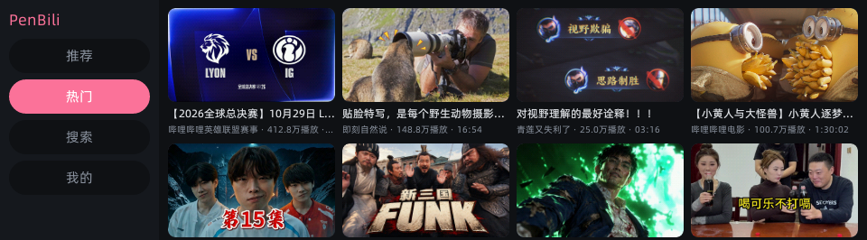
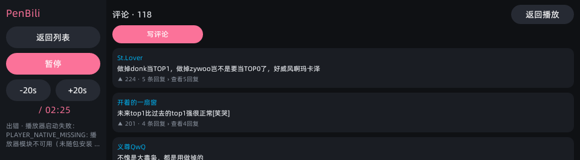
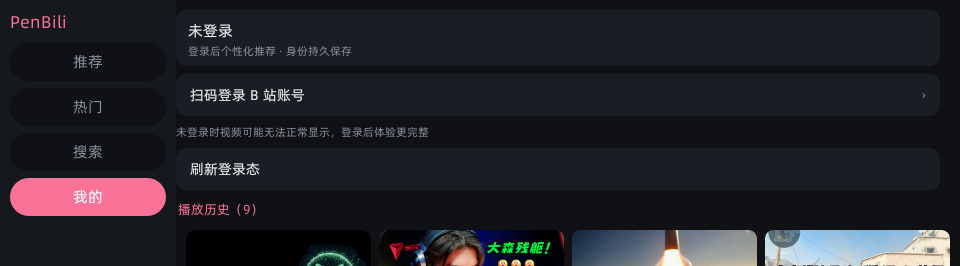
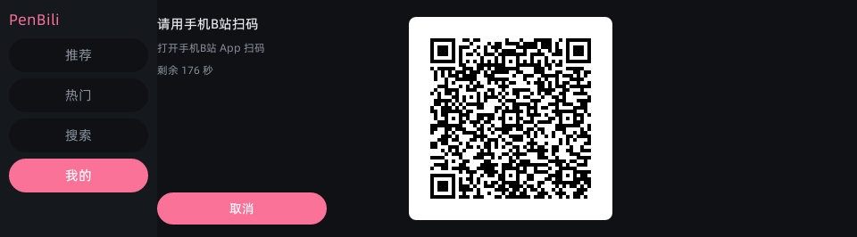
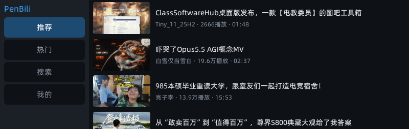
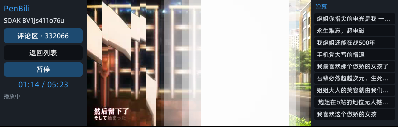
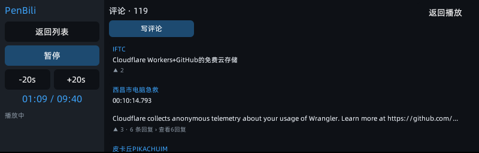

# PenBili

**有道词典笔（X5 / X6 Pro）上的哔哩哔哩播放器**（Falcon / QuickJS mini-app，Vue 2 SFC）。本发布以仓库 `v2.7.0` 源码为基线，当前版本号为 `3.0.0`。

在逻辑分辨率 800×254（X5）与 **960×266（X6 Pro）** 的设备屏幕上提供推荐流、DASH 播放、视频/图文/直播三栏搜索、图文阅读、评论浏览/发表、TV 协议扫码登录与播放历史。

> **X6 Pro 适配**：屏幕从 800×254 换成 960×266，界面按 iPad 版 B 站重做——左侧窄导航栏（76px，只包住按钮文字）+ 884px 内容区 5 列封面卡片网格；播放页为 64px 纯图标栏（返回 / 点赞 / 投币 / 收藏 / 播放暂停，点赞投币收藏放大且计数在图标下方）+ 432px 视频区（与图标栏留 16px 间距）+ 448px 右栏（默认评论区，点收藏切换到收藏夹覆盖层）+ 视频下方可拖动进度条。配色 B 站粉 `#FB7299` / 蓝 `#00AEEC`。真机几何常量、测量方法与踩坑记录见 **[`docs/x6pro-adaptation.md`](docs/x6pro-adaptation.md)**，播放链路见 **[`docs/x6pro-video-playback.md`](docs/x6pro-video-playback.md)**。

弹幕已于 v2.7.0 移除，以避免弱设备上的逐帧文字渲染拖慢视频解码。

> **`2.9.0` 变更**：**直播间播放上线** —— 搜索三栏的「直播」由占位转为可用：直播间经**服务端转码**取 360/480/540p 流（服务端以 **HLS 分片**回传，笔端当点播地址播放）；「我的 → 直播设置」配置转码服务器地址与起播缓冲，并带**重定向解析缓存**（外网端口每次打洞都会变，启动时 2s 探测、失效自动重解析）。
> **`2.9.1` 变更**：**修掉搜索偶发「B站 code=?：WBI 密钥获取失败」** —— 根因是笔端 HTTP 栈偶发 DNS 解析超时（真机 `YHttpManager` 日志 `Resolving timed out after 6000 milliseconds`，连系统自有域名一起偶发），`nav` 取签名密钥被殃及。改为**短退避重试 3 趟（jsapi → native libcurl → jsapi）+ 双栈兜底**，单趟超时收敛到 7s；同时把真实失败原因（stage/code）透传到界面，不再只显示 `code=?`。新增 `wbiStress` 诊断种子与 5 条单测（107 条全绿）。
> **`2.9.2` 变更**：**修掉直播卡顿/帧率低（~4fps）且无声** —— 根因是 native 播放器的「音频锚节流」在**单进程音视频**路径（直播）上形成自锁：视频 pipe 上限仅 1MB、音频 writer 要等环形缓冲蓄满 800ms 才开写、而 ffmpeg 同进程产出音视频 → 视频 writer 等音频锚（恒 0，实测 `drift ≡ -frames×33ms`）每帧撞满 200ms 限幅 → ffmpeg 被满 pipe 堵死 → 环永远蓄不满 → **帧率恒 4.2fps 且 aplay 全程无数据（无声）**。改为**直播走墙钟节拍**（`duration_ms<=0`）+ **直播关闭水位滞回**（可闻滞后收敛到管道+ALSA ≈0.56s）+ 墙钟基线对齐首帧、并按音频管道延迟补偿画面。同时把直播默认画质从 480p 改为 **254（= 视口 452×254，1:1 无缩放）**：480p 在本机软解+缩放+转置+rgb32 链上只有 0.83x（必卡），254 有 2.3~2.8x。实测：**4.2fps → 30.0fps**、音频 19.7KB/s → **176KB/s（实时）**、欠载 0、音画偏移稳定 -0.5s（不再漂移）。
> **`2.9.3` 变更**：**给笔端真正加上缓冲，消掉「卡一下→画面突然加快」的循环**。① 笔端的缓冲深度由**两条管道**决定（视频 pipe = 画面延迟、aplay pipe = 声音延迟），而视频 pipe 的 8MB 扩容**一直没生效**（`/proc/sys/fs/pipe-max-size` 默认 1MB 把申请顶回去，程序无 CAP_SYS_RESOURCE）→ 现在启动时先放宽该 sysctl，视频 pipe 实测拿到 **32MB（≈1.5–2s 存量）**，直播同时把 aplay 管道加深到 256KB（≈1.68s）使两侧量级相当；② 墙钟落后时的追赶**限制在 1.25 倍速**（原来是不限速快放，所以观感是「整段突然加快」）；③ 新增**自适应音画对齐伺服**：用实测 avDrift 反向微调画面目标，把这台设备/这套缓冲下的残差压到 **±30ms**（起播约 10s 内收敛）。另：把设置项「起播缓冲」正名为 **「服务端分片窗口」**——它只决定服务端保留多少分片（笔端落后时的抗抖动余量），**并不影响起播时间**（此前命名误导）。
> **`3.0.0` 变更（X6 Pro）**：**芯片硬解 + 直播去云端转码 + 界面重做**。
> ① **视频硬解**：X6 Pro 是 RK3562，带 MPP 视频解码单元。`ffmpeg` 只做 demux + `-c:v copy`（把压缩包原样搬进 FIFO），解码交给 GStreamer 的 `mppvideodec`，再直接送 `kmssink`（DRM 平面 76）上屏。实测 720p **33x 实时**，CPU 从「软解 + 每帧 rgb32 拷贝」降到「只搬压缩包」。旋转也交给解码器（`mppvideodec rotation=`），不再走 ffmpeg `transpose` 滤镜。
> ② **直播改本地直连**：X5 时代 4×A53 软解 720p 只有 0.76x 实时，只能靠自建转码服务器把 480p30 HLS 推回来。X6 Pro 上这条链路**整体删除**——笔端直接调 `getRoomPlayInfo` 取 `http_stream/flv/avc` 直链（实测 1.2~2.2Mbps，设备外网吞吐 10Mbps），本机硬解播放。「我的 → 直播设置」（服务器地址 / 分片窗口 / 画质档 / 测连 / 解析缓存）随之移除。
> ③ **界面重做**：见上方 X6 Pro 适配说明。
> ④ **互动补齐**：播放页左图标栏接入点赞 / 投币 / 收藏（含收藏夹选择），右栏三态切换，底部进度条可拖动定位。

> **`2.9.4` 变更**：**修掉「连续播放 30 分钟后音频落后视频约 1.5 秒」+ 打通外网直播链路**。
> ① **音视频分离双进程**：单进程 ffmpeg 串行写视频/音频两个输出，视频 pipe（32MB 缓冲）被填满时 ffmpeg **整体阻塞** → 音频同停 → 环/管道被抽干 → ALSA underrun（真机实测 8 次、最长 2.36s）→ **音频内容永久落后**（累计 3.17s）。改为视频进程 + 音频进程各自独立拉同一条转码地址，视频背压不再牵连音频产出。
> ② **外网链路修复**（STUN 打洞 + Cloudflare 301 场景）：CF 的 301 规则**会丢弃 query string**（`best/live?room=...` → `xyz:端口/live`，服务端 400）；`jsapi.http` 不跟随 301，重定向解析改走 **native libcurl**（`FOLLOWLOCATION=1`）拿终点 host 回写 `resolvedAddr`，播放直连打洞地址绕过 301；降级（解析失败）不再回写缓存；探测超时 2s/5s → 8s/15s（打洞端口 TCP connect 实测可达 5s+）；直播首帧上限 15s→60s、并禁用断流重启（`-ss` seek 对 HLS 直播滑动窗口无效，会卡死循环）。
> **30 分钟外网长测**（某在播房间，手机热点 + STUN 打洞）：帧率 **29.95fps**、位置增速 **1.00x 实时**、**underrun 0 次**（修复前 8 次累计 3.17s）、丢帧/重启 0；音画偏移 `d` 全程稳定，仅 19.7 分钟处一次外网抖动导致音频进程短暂断供 ~2s（偏移最深 -2232ms），**伺服 30s 内自愈到 -40ms，无永久落后**（修复前会永久落后 1.5s）。


## 截图

**X6 Pro（960×266，B 站风格界面）**

**推荐流**


**热门**



**搜索（图文栏）**


**图文详情**


**评论区**



**我的**



**扫码登录**



以上为 X6 Pro 真机 `miniapp_cli capture` 采集（截图为 Falcon 画布，不含 DRM 视频平面）。

**X5（800×256，`2.7.1` 旧界面）**

**主页（推荐流）**



**播放中**



**评论区**



以上为 `2.7.1` 在真机 有道 X5 上的实测截图  

## 功能

- **播放**：DASH 分离视频与 AAC 音轨，**按 qn 阶梯请求最高可用档**（`116`=1080P60 → `80`=1080P → `74`=720P60 → `32`=480P → `16`=360P），同档内优先 AVC、再按分辨率与帧率取最高；必要时回退单文件流；按视频实际宽高信箱适配，支持 ±20 秒定位与播放历史。未登录时服务端最高只给 480P30，登录后才会给到 1080P。
- **音画同步**：轻微漂移时平滑追赶；音频领先超过 1 秒时只重启视频流并重新对齐，音频不中断；首帧等待有 15 秒上限，失败后自动恢复。
- **网络抖动缓冲**：FFmpeg 输入线程预取压缩数据包（视频队列 300、音频队列 700）；它不是解码后的视频帧缓存，也不保证所有网络条件下固定 15 秒可用缓冲。
- **音频**：独立解码进程与音频环形缓冲，支持设备默认输出和 A2DP 音频路由。
- **评论**：分页浏览、子回复、系统输入法发表评论；评论面板打开时维持音频播放并避免视频闪烁；评论类型参数化（视频=1、专栏图文=12）。
- **搜索**：关键词搜索，结果分「视频 / 图文 / 直播」三栏，各自独立缓存与分页。
- **直播播放**：搜索直播间 → 直接调 `getRoomPlayInfo` 取 `http_stream/flv/avc` 直链，笔端本地解码播放，不再依赖任何自建服务器。`durationMs=0` → 不判播完、不提供定位；直播地址带 `expires`，过期后自动重取一次。未登录上限 720p（`current_qn=250`）。
- **图文阅读**：专栏详情以文本/图片混排块渲染（opus 结构化段落优先，content HTML 兜底）；正文按块级标签分段（每段独立成块），段内 `<br>` 视为软换行；`/x/article/view` 需 WBI 签名，走 native libcurl 传输并携带完整浏览器头（瘦请求头会被风控判 -352）；图片按原始比例等比渲染。
- **登录**：TV 协议扫码登录、登录态持久化、过期检查与刷新。

## 设备与兼容性

| 项目 | 值 |
| --- | --- |
| 机型 | 有道词典笔 X5 / **X6 Pro** |
| 运行时 | Falcon mini-app / QuickJS 20200705 |
| 逻辑屏幕 | X5：800×254　**X6 Pro：960×266** |
| 视频区域 | X5：452×254　**X6 Pro：432×240**（另留 16px 与图标栏间距），均按源视频宽高信箱适配 |
| 面板朝向 | `direction = 270`，物理面板 480×960（X6 Pro） |

两套几何由 `src/app.js` 的 `DESIGN_WIDTH` 与 `src/services/screen.js` 的
`LOGICAL` / `PHYSICAL` / `VIDEO_COL_WIDTH` / `BAR_WIDTH` 决定；X6 Pro 的真机测量过程见
[`docs/x6pro-adaptation.md`](docs/x6pro-adaptation.md)。

设备画像、诊断日志、运行截图及本地环境信息不随此版本分发。更换设备或固件时应重新验证屏幕几何与解码能力。

## X6 Pro 适配待办

- [x] 逻辑画布 960×266（`src/app.js` `DESIGN_WIDTH = 960`）
- [x] 三栏骨架 176 / 608 / 176，几何纯函数与单测同步到 960×266
- [x] B 站风格视觉重做（`src/styles/var.less` + `src/styles/base.less`）
- [x] 封面图 CDN 重写（`src/services/imgurl.js`，规避 hdslb 域名解析失败）
- [x] 历史封面同样归一化（`src/services/history.js`）
- [x] `flex: 1` 简写改长写（Falcon 运行时简写会算错 flex 子项宽度）
- [x] aarch64 `libjsapi_httpjson.so` 落地 → 图文详情、扫码登录恢复
- [x] aarch64 `libjsapi_player.so` 落地（MPP 硬解 + KMS 平面直出）→ 播放态恢复

## 性能诊断记录

X6 Pro 换用芯片硬解后，视频解码不再占用 CPU。`ffmpeg` 只做 demux 与容器解包（`-c:v copy`），
压缩后的 H.264 Annex-B 码流经 FIFO 交给 `mppvideodec`，解码结果直接由 `kmssink` 送上 KMS 覆盖平面。
实测 640×360@30 的直播源，解码吞吐约 **33 倍实时**——瓶颈完全落在网络而非算力。

画面节拍以音频时钟为锚：每帧按 `1/fps` 排程，再用「当前可闻音频位置 − 本帧应有位置」的残余漂移
做 ±1~3ms 的低通微调，而不是硬等到音频位置跨过阈值才放行。早期版本正是硬等音频锚（以 8KB
写块为单位，约 46ms 一台阶），导致连续几帧卡在同一台阶、台阶一跳又整批放行，
表现为**约每秒一次的顿挫**；改为节拍器后实测相邻两次上屏的最大间隔从 126ms 降到 30~33ms
（正好一帧），丢帧计数从 544 降到 2，音画漂移稳定在 ±60ms 内。

旋转交给解码器：`mppvideodec` 自带 `rotation` 属性，直接按面板朝向（`direction=270`）出正立画面，
不需要 `videoconvert` 之类的软件转换，也省掉了整帧旋转的 CPU 开销。

## 构建与测试

前置：Node.js 18+、有道小程序打包器 **aiot-vue-cli**（1.0.32 验证）；重建 native 库另需 Zig。

X6 Pro 是 aarch64，native 库必须用 `aarch64-linux-gnu.2.17` target 重建（`EI_CLASS=64`、`machine=183`）；
X5 用的是 `arm-linux-gnueabihf.2.23`。32 位库在 X6 Pro 上会被 `dynamic_load_jsapi` 直接拒绝
（`wrong ELF class: ELFCLASS32`）。

```bash
npm ci
npm test                    # 107 条逻辑、协议与几何回归测试（含图文正文解析、直播地址/画质档与重定向缓存）
node test/qr_login_test.js  # 21 条登录协议测试

# 打包 AMR（QuickJS 生产包）
npm run build

# 可选：从 native 源码重建库
# PowerShell: $env:ZIG_EXE = 'C:\path\to\zig.exe'; npm run native
```

## 安装与真机自检

具体命令以设备上的 `miniapp_cli --help` 为准：

```bash
adb push PenBili.amr /tmp/PenBili.amr
adb shell miniapp_cli install /tmp/PenBili.amr
adb shell miniapp_cli start 8002026091900004 index   # 页面名**不带** `--`；写成 `--index` 会报 could not load module filename '--index.js'
```

本地部署、自检与截图采集：`npm run deploy`（依赖 ADB 可访问设备）。

## 致谢

- [SocialSisterYi/bilibili-API-collect](https://github.com/SocialSisterYi/bilibili-API-collect)：
  我基本是照着这份接口文档把点赞、投币、收藏、评论一路接完的，省了大量抓包时间。
- 有道 Falcon 小程序的官方示例与 `falcon-ui` 组件库：布局、样式和触摸事件的行为都以它为准。

## 免责声明

- 本项目为个人学习用途，与哔哩哔哩、有道（网易）均无关联；相关商标归其权利人所有。
- `native/iot-miniapp-sdk/include` 为有道小程序官方 SDK 头文件，仅作为 native 模块的编译依赖随仓库分发；版权归原权利人，不适用于本仓库 GPL-3.0 授权。
- 使用本软件访问服务时请遵守哔哩哔哩用户协议；账号安全责任自负。
- **无任何担保**；详见 LICENSE。

## 许可证

[GPL-3.0](LICENSE)（GNU General Public License v3.0）
